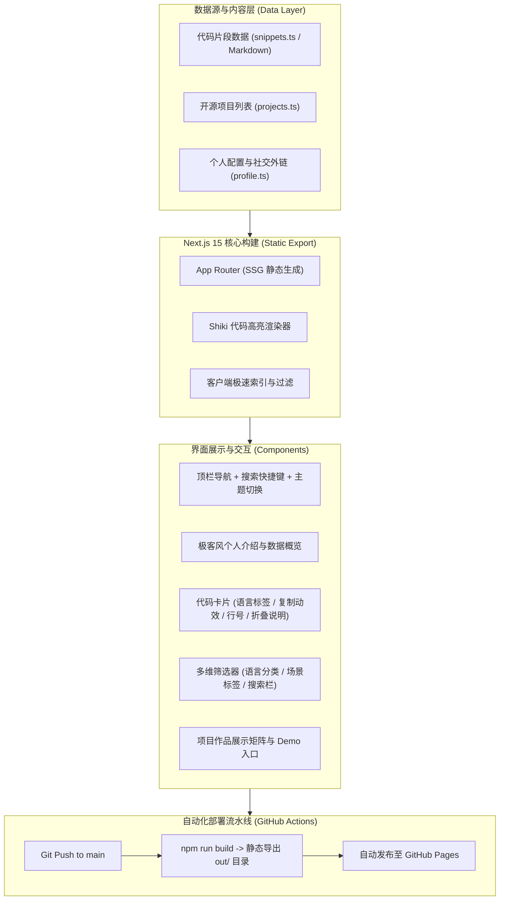

# 个人代码分享主页 (Developer Code Portfolio) 总体规划方案

本项目旨在为开发者量身打造一个**高颜值、高性能、专注于高质量代码分享与技术沉淀的现代化个人主页**。网站不仅作为个人开发者名片与作品展示窗口，核心还在于提供一套体验极佳的**代码片段库（Code Snippets Hub）**，方便读者查找、阅读、一键复制代码及查看原理解析。

---

## 1. 核心架构与技术选型

| 模块 | 选型 | 优势与说明 |
| :--- | :--- | :--- |
| **核心框架** | **Next.js 15 (React 19 / App Router / TypeScript)** | 全栈生态成熟，开发体验流畅，支持极速静态导出 (SSG) |
| **样式与系统** | **Tailwind CSS + Lucide React 图标库** | 现代化原子化样式，代码体积小，图标轻量精致 |
| **代码高亮引擎** | **Shiki (VS Code 级语法着色引擎)** | 采用 VS Code 官方 TextMate 语法树，原生支持双主题（深色/浅色高亮精确无误） |
| **状态与主题** | **next-themes** | 支持系统自适应与平滑切换，无页面加载白屏闪烁问题 |
| **部署方案** | **GitHub Pages + GitHub Actions** | 配置 `output: 'export'` 纯静态导出，推送代码后全自动构建与发布，永久免费且稳定 |

### 整体架构流程图



---

## 2. 核心功能模块规划

### 2.1 首页 (Hero & Overview)
- **开发者 Profile 卡片**：
  - 头像、个性化昵称、专业角色标签（如 Full-Stack Engineer / Open Source Enthusiast）。
  - 个性化 Slogan、当前专注方向（Current Focus）。
  - 社交外链矩阵（GitHub、Twitter/X、邮箱、博客等）。
- **精选代码速递 (Featured Snippets)**：
  - 精选展示 2~3 个最具实用价值或代表性的代码实现。
  - 支持直接在首页查看、一键复制代码、或跳转到完整代码库。
- **代表开源项目 (Featured Projects)**：
  - 展示 2~4 个重点开源项目或独立作品，附带技术徽标、在线 Demo 按钮与 GitHub 源码链接。

### 2.2 代码片段库 (Code Snippets Hub) - 核心模块
- **多维度筛选与过滤**：
  - **按语言过滤**：`TypeScript`, `JavaScript`, `Python`, `Go`, `Rust`, `Shell/Bash`, `CSS/Tailwind`, `SQL`, `Docker` 等。
  - **按场景标签**：`常用工具`, `自定义 Hook`, `算法与结构`, `性能优化`, `工程配置`。
- **即时搜索 (Instant Search)**：
  - 输入框支持对标题、说明摘要、语言标签进行毫秒级实时模糊匹配检索。
- **极致代码阅读体验 (Code Block)**：
  - **VS Code 级语法高亮**：采用 Shiki 精确着色。
  - **一键复制代码**：点击后显示动效与 Tooltip 成功反馈，精确保留缩进。
  - **代码行号**：等宽字体（JetBrains Mono / Fira Code）排版，提升可读性。
  - **折叠式使用示例与解析**：附带使用示例（Usage Example）与核心原理解析。

### 2.3 开源项目展示页 (Projects Showcase)
- 卡片化网格展示所有个人作品与开源仓库。
- 包含：项目封面/截图、项目简述、核心解决的痛点、技术栈 Tag、Live Demo 体验入口、GitHub 源码入口。

### 2.4 关于我页面 (About Me)
- 个人详细经历与技术背景。
- 技能矩阵（前端、后端、DevOps、工具链等）。
- 联系方式与交流讨论指引。

### 2.5 全局基础与体验能力
- **深色 / 浅色模式**：默认跟随系统偏好，支持顶部一键平滑切换，状态本地持久化存储。
- **全端响应式设计**：专为移动端手机、平板、桌面超宽屏优化布局。
- **静态导出与 SEO 友好**：预生成全量静态 HTML，利于搜索引擎抓取，CDN 秒级加载。

---

## 3. 代码片段数据模型设计 (示例)

每个代码片段将采用结构化数据定义（易于扩展与维护）：

```typescript
export interface Snippet {
  id: string;               // 唯一标识 (如 'react-use-debounce')
  title: string;            // 标题 (如 '自定义防抖与节流 Hook')
  description: string;      // 简短说明
  language: string;         // 语言 ('typescript' | 'python' | 'shell' 等)
  category: string;         // 分类 ('React' | 'Utils' | 'DevOps' 等)
  tags: string[];           // 标签 (['Hook', 'Performance'])
  code: string;             // 代码正文
  explanation?: string;     // 原理解析或注意事项 (支持 Markdown)
  usage?: string;           // 调用示例代码
  createdAt: string;        // 发布时间
}
```

---

## 4. 目录与工程文件结构规划

```text
├── .github/
│   └── workflows/
│       └── deploy.yml               # GitHub Actions 自动化构建部署脚本
├── public/                          # 静态资源 (头像、Favicon、截图)
├── src/
│   ├── app/                         # Next.js 15 App Router 路由
│   │   ├── layout.tsx               # 根布局（包含导航栏、底栏、主题提供器）
│   │   ├── page.tsx                 # 首页 (Hero + 精选代码 + 精选项目)
│   │   ├── snippets/
│   │   │   └── page.tsx             # 代码片段库主页 (含筛选与即时搜索)
│   │   ├── projects/
│   │   │   └── page.tsx             # 项目展示页
│   │   └── about/
│   │       └── page.tsx             # 关于我页面
│   ├── components/
│   │   ├── layout/
│   │   │   ├── Header.tsx           # 顶栏导航与状态
│   │   │   ├── Footer.tsx           # 底栏与版权
│   │   │   └── MobileNav.tsx        # 移动端折叠导航
│   │   ├── theme/
│   │   │   ├── ThemeProvider.tsx    # 主题上下文
│   │   │   └── ThemeToggle.tsx      # 深浅色切换按钮
│   │   ├── snippets/
│   │   │   ├── CodeBlock.tsx        # 高亮代码块 (含复制/行号/语言标签)
│   │   │   ├── SnippetCard.tsx      # 代码片段概览卡片
│   │   │   └── SnippetFilter.tsx    # 语言与标签过滤栏
│   │   └── projects/
│   │       └── ProjectCard.tsx      # 项目卡片组件
│   ├── data/
│   │   ├── profile.ts               # 个人资料与社交链接配置
│   │   ├── snippets.ts              # 代码片段数据集合 (支持轻松追加)
│   │   └── projects.ts              # 项目列表数据
│   ├── lib/
│   │   ├── highlighter.ts           # Shiki 代码高亮工具与主题映射
│   │   └── utils.ts                 # 辅助函数与样式合并
│   └── styles/
│       └── globals.css              # 全局样式与自定义代码主题滚动条
├── next.config.ts                   # Next.js 静态导出配置 (output: 'export')
├── tailwind.config.ts               # Tailwind 样式配置
├── tsconfig.json                    # TypeScript 配置
└── package.json
```

---

## 5. 分阶段实施路线图

### 阶段 1：脚手架与基础环境初始化
- [ ] 创建 Next.js 15 + TypeScript + Tailwind CSS 工程。
- [ ] 安装核心依赖：`lucide-react`, `shiki`, `next-themes`, `clsx`, `tailwind-merge`。
- [ ] 配置 `next.config.ts` 的静态导出 (`output: 'export'`) 和 `images.unoptimized: true`。

### 阶段 2：公共布局与主题系统
- [ ] 配置设计系统调色板与全局深色/浅色模式切换。
- [ ] 实现响应式导航顶栏 `Header` 与底栏 `Footer`。
- [ ] 实现移动端抽屉导航。

### 阶段 3：代码高亮器与代码展示组件
- [ ] 封装服务端/构建期高亮工具 `highlighter.ts`，基于 Shiki 生成带 VS Code 主题色彩的 HTML。
- [ ] 封装 `CodeBlock` 组件：语言 Tag 标签、一键复制代码（带状态动画反馈）、行号美化与横向滚动优化。
- [ ] 编写首批高质量示例代码数据（覆盖 TypeScript、Python、Shell 等典型应用场景）。

### 阶段 4：代码片段库（搜索与分类交互）
- [ ] 实现多维度分类过滤切换（语言/标签）。
- [ ] 实现毫秒级即时文本过滤与搜索栏。
- [ ] 实现代码片段展开详情、调用示例展示。

### 阶段 5：首页、项目展示页与关于我页面
- [ ] 完成首页个人介绍 Hero、精选代码卡片与开源项目。
- [ ] 完成项目作品展示列表页面。
- [ ] 完成关于我（技能树、履历、联系方式）页面。

### 阶段 6：构建测试与 GitHub Pages 自动化部署
- [ ] 本地全量打包测试（`npm run build`），确保静态文件导出零错误。
- [ ] 编写 `.github/workflows/deploy.yml` 自动化 CI/CD 流水线，实现代码推送自动构建上线。
- [ ] 提供使用与维护手册（如何新增代码片段、修改个人配置）。
